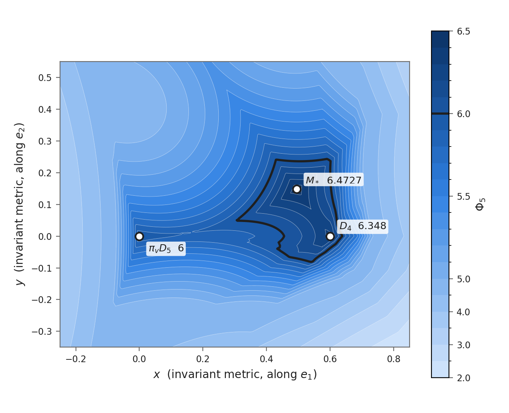

# The surprise: M\*

The natural guess was that D₄ is the worst four-dimensional shadow. It is the densest lattice in four dimensions, the most symmetric, and the shadow of D₅\*, one of the two winners. If $\Phi_5$ peaked at D₄, the proof of $\eta_5 = 6$ would need a finer bound near D₄ and nothing else.

That guess was wrong. $\Phi_5$ goes higher, at a lattice that doesn't seem to appear in the literature.

## Walking away from D₄

Take a path through the space of four-dimensional lattices that starts at D₄ and ends at another isodual lattice, $A_2 \otimes A_2$. That lattice is built from two copies of the hexagonal lattice, a "product" of two honeycombs. The path is the straightest one available, a geodesic in the natural metric on Gram matrices (the one that measures how far you have to stretch one Gram matrix to reach another).

The figure below plots $\Phi_5$ along that path.

In the paper: Figure 1. The data are numerics/geodesic_phi5.txt in the certificate repository.
{ .paper-ref }

Leaving D₄ the curve first dips slightly, then climbs. At distance $\ln\tfrac65 \approx 0.182$ from D₄ it reaches a peak above D₄'s value, and only then falls towards $A_2\otimes A_2$, which sits at distance $\ln2$, at the value $16/3$. The dashed line is 6. A proof through $\Phi_5$ alone would need the whole curve, and every other lattice, below it.

The curve is numerical: at each of 66 points, $\kappa$ was computed by a floating-point branch and bound over the torus of lifting forms, to relative accuracy $10^{-8}$, and $\eta$ by exact minimisation. The three marked values are exact.

## Who M\* is

The peak is a lattice called $M_*$ in the paper. It has an integral Gram matrix

$$
P_0 = \begin{pmatrix} 18 & -9 & 0 & 0 \\ -9 & 18 & -9 & -9 \\ 0 & -9 & 16 & 1 \\ 0 & -9 & 1 & 16 \end{pmatrix}, \qquad \det P_0 = 135^2,
$$

and at the peak

$$
\Phi_5(M_*) \;=\; \frac{2^{16}}{3^4\cdot 5^3} \;=\; \frac{65536}{10125} \;\approx\; 6.4727,
$$

with $\kappa(M_*) = \sqrt{12/5}$ and $\eta(M_*) = 2^{14}/(3^5 \cdot 5^2) \approx 2.6970$.

In the paper: Definition 16, Proposition 17.
{ .paper-ref }

It is a curious object. It is not very dense: its Hermite invariant is $16/\sqrt{135} \approx 1.377$, below D₄'s $\sqrt2 \approx 1.414$, and it has 9 pairs of shortest vectors against D₄'s 12. It has 72 symmetries.

It is isodual, and more precisely *even and 135-modular*. Scale it so that its Gram matrix is $P_0$, and $135\,P_0^{-1}$ is another even integral Gram matrix of the same lattice. It is also the unique densest lattice in its genus. The genus of $P_0$, the lattices that look the same as $M_*$ locally at every prime, has six classes, and $M_*$ has the largest minimum among them.

Some of its symmetries act like multiplication by a cube root of unity $\omega$. That makes $M_*$ a rank-2 lattice over the [Eisenstein integers](https://en.wikipedia.org/wiki/Eisenstein_integer) $\mathbb Z[\omega]$, with Gram matrix

$$
H = \begin{pmatrix} 8 & 3 - 2\omega \\ 3 - 2\bar\omega & 8 \end{pmatrix}, \qquad \det H = 45.
$$

The Eisenstein integers are the hexagonal lattice viewed as numbers, so in this sense $M_*$ is a hexagonal lattice of hexagonal lattices, glued in a twisted way. Finally, it is symplectic, in the sense of Bergé and Buser–Sarnak. Up to scale it lies on families of lattices that carry a [symplectic](https://en.wikipedia.org/wiki/Symplectic_vector_space) structure, as NTRU lattices do.

In the paper: Proposition 17 (4)–(8) and §6.
{ .paper-ref }

The paper reports that $M_*$ is not in the Nebe–Sloane catalogue of lattices, whose four-dimensional modular lattices go up to level 15, and not in Conway and Sloane's paper on isodual lattices. It is not one of Kirschmer's Hermitian lattices of small class number either. For anyone who wants to look it up, its theta series begins $1 + 18q^{16} + 6q^{18} + 6q^{30} + 18q^{34} + \cdots$.

## Where it sits

$M_*$ lies exactly on the geodesic from D₄ to $A_2 \otimes A_2$, at parameter $\log_2\tfrac65$. The distances are tidy:

$$
d(D_4, M_*) = \ln\tfrac65, \qquad d(M_*, A_2\otimes A_2) = \ln\tfrac53, \qquad d(D_4, A_2\otimes A_2) = \ln 2.
$$

All three lattices on the path have a story. D₄ is the shadow of D₅\*. $A_2\otimes A_2$ is a shadow of a shadow of E₆. $M_*$, in between, is not known to be the shadow of anything special. It is just where $\Phi_5$ is highest.

In the paper: §6 and Remark 24.
{ .paper-ref }

## Why the bound fails there

The paper proves that $M_*$ is the global maximum of $\Phi_5$: every four-dimensional lattice has $\Phi_5 \le 2^{16}/(3^4\cdot5^3)$, with equality only at lattices similar to $M_*$. That is a computer-assisted theorem, of the kind described in chapters 8–10.

In the paper: Theorem 20, Proposition 22.
{ .paper-ref }

So the best the natural proof can ever give is

$$
\eta_5 \;<\; 6.4727.
$$

The trouble is that the bound is badly loose at $M_*$. The lift that attains $\kappa(M_*)$, called $L_*$, has

$$
\eta(L_*) = \frac{486}{125} = 3.888,
$$

nowhere near 6.47. The inequality $\eta(L) \le \gamma(L)^{5/2}\,\eta(\pi_vL)$ loses almost everything here. Numerically, the lifts over $M_*$ with the largest $\eta$ reach only about 5.16.

In the paper: Remark 18; the display after Remark 23 and the sentence after it (5.16, numerical).
{ .paper-ref }

Each of the three peaks loses in a different place. At D₅ neither inequality is lost, and $\eta(D_5) = \Phi_5(\pi_vD_5) = 6$. At D₅\* the $\kappa$ step is lost, by the factor $(36/35)^2$, so $6 < \Phi_5(D_4) \approx 6.348$. At $L_*$ the splitting step is lost, and $3.888 < \Phi_5(M_*) \approx 6.4727$.

## The landscape

The geodesic is one line through a nine-dimensional space. A wider view, still numerical, suggests that $\Phi_5$ has three peaks that matter.

- the shadow of D₅, $\pi_vD_5$, at exactly 6, a sharp local maximum (proved);
- D₄, at about 6.348, which appears to be a local maximum (numerical);
- $M_*$, at 6.4727, a sharp local maximum (proved) and the global one (proved).

The region where $\Phi_5 > 6$ appears to be a neighbourhood of D₄ and $M_*$, joined by a pass at about 6.28 and separated from $\pi_vD_5$.

In the paper: Remark 23, Figure 2.
{ .paper-ref }

The picture below is $\Phi_5$ on the flat slice through all three lattices, with $\pi_vD_5$ at the origin, D₄ at distance 0.600 and $M_*$ at 0.517.

<figure class="contour" markdown>

<figcaption>Φ₅ on the 2-plane through πvD₅, the nearest copy of D₄ and the nearest copy of M*, in coordinates that measure true distance from πvD₅. The bold curve is Φ₅ = 6. Numerical (floating point), not certified. The paper's Figure 2.</figcaption>
</figure>

The same data as a landscape you can turn around. Heights are $\Phi_5$, and warm colours mark where it rises above 6. The grey sheet is the level 6, the value of $\eta_5$. Two peaks poke through it, D₄ and the higher $M_*$. The third peak, $\pi_vD_5$, the shadow of D₅, just touches the sheet.

This is a two-dimensional slice of a nine-dimensional landscape, so it can't show everything. It does show why the first stage of the proof has to stop near D₄ and $M_*$, and why it has no trouble near $\pi_vD_5$, whose peak reaches exactly 6 and no higher.

## What this means for the proof

The paper's search does the following. A first computer search over four-dimensional shadows shows $\Phi_5 < 6$ everywhere except in a small region around D₄ and $M_*$, and collects the boxes it cannot close. A second search goes back up to five dimensions over just those boxes, and bounds the actual lifts directly, without passing through $\Phi_5$. Numerically, the lifts over $M_*$ stay far from 6, so the second stage has room, and the lifts over D₄ reach 6 only at D₅\* itself.

The obvious candidate turned out not to be the answer. The lattice where $\Phi_5$ is highest, $M_*$, has nothing to do with the five-dimensional answer, except that it got in the way.

The next three chapters show how the computer search works and why it can be trusted.
